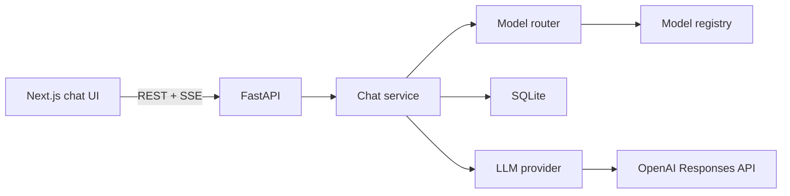

# OperateSolve

OperateSolve is a local AI copilot for enterprise operations. Phase 1 is a dark, multi-turn chat workspace: conversations persist in SQLite, replies stream from the OpenAI Responses API, and each answer shows model, latency, and token usage. **Phase 2 is complete** (see [`PHASE2_COMPLETION.md`](PHASE2_COMPLETION.md)): usage and cost dashboard (2.1), per-conversation model selection with deterministic routing (2.2), prompt-cache tuning and measurement (2.3), model-aware context budgets with summarization (2.4), schema-enforced incident analysis (2.5A), and a sequential-vs-parallel LLM experiment (2.5B).

The OpenAI API key stays in `backend/.env`. The browser only talks to the local FastAPI server.

## Architecture

```text
frontend/   Next.js App Router, TypeScript, Tailwind, shadcn/ui
backend/    FastAPI, SQLite, OpenAI Responses streaming
```



Request flow:

1. The UI creates a conversation, then posts a message with a client request id and the selected model preference.
2. The router picks the model, then the API stores the user turn and an assistant placeholder before calling it. If the chosen model is unavailable, nothing is stored and the API returns 409.
3. Text deltas stream back as server-sent events. The final event includes usage and latency.
4. A repeated post with the same client request id replays the saved answer and does not call the model again.
5. Stop, network failure, or an API error leaves a partial or failed assistant message that can be retried.

Layers, so later phases can plug in without rewriting the chat route:

| Area | Location | Phase 1 behavior |
| --- | --- | --- |
| HTTP | `backend/app/api` | Health, chats, streaming messages |
| Orchestration | `backend/app/services/chat_service.py` | Context, idempotency, metrics |
| Model provider | `backend/app/services/llm` | OpenAI Responses streaming. Add vendors in `factory.py` |
| Model registry | `backend/app/services/llm/registry.py` | Model ids, display names, capabilities, reasoning settings, deprecation dates, availability (Phase 2.2) |
| Model router | `backend/app/services/model_router.py` | Deterministic manual/Auto selection and fallback (Phase 2.2) |
| Data | `backend/app/db` | SQLite conversations, messages, per-request LLM usage |
| Usage and cost | `backend/app/services/pricing.py`, `usage_service.py`, `backend/pricing.json` | Token accounting and estimated USD cost (Phase 2.1), cache hit rate and savings (Phase 2.3) |
| Prompt caching | `backend/app/services/llm/prompt_cache.py`, `backend/scripts/cache_experiment.py` | Per-model cache request settings and a manual experiment (Phase 2.3) |
| Context & summaries | `backend/app/services/context/` | Token budgets, sliding-window history, incremental summarization (Phase 2.4) |
| Incident analysis | `backend/app/services/incident_service.py`, `/incidents` | Schema-enforced Structured Outputs (Phase 2.5A) |
| LLM experiments | `backend/app/services/parallel_experiment_service.py`, `/experiments` | Sequential vs parallel latency demo (Phase 2.5B) |
| Future RAG, agents, MCP, auth | `backend/app/extensions.py` | Hooks are called and currently no-op |

The default and baseline model is `gpt-6-luna`. `OPENAI_REASONING_EFFORT` defaults to `low` so replies stay responsive. Set it to `none` for the lowest latency and cost, or `medium` for deeper answers. Output token counts include reasoning tokens when the API reports them that way. If usage is missing, the UI shows "usage unavailable" instead of inventing numbers.

## Model selection and routing (Phase 2.2)

The composer has a compact model selector with four choices: **Auto**, **Luna**, **Mini**, and **Nano**. When Auto is selected, a Simple / General / Detailed switch appears next to it. The choice is saved per conversation, so reopening a conversation restores it. You can switch models in the middle of a conversation; the next reply gets the full history, whichever model answers.

### Models

Checked on 2026-10-25 against the OpenAI [model pages](https://developers.openai.com/api/docs/models/gpt-6-luna), [pricing](https://developers.openai.com/api/docs/pricing), [deprecations](https://developers.openai.com/api/docs/deprecations), and [reasoning guide](https://developers.openai.com/api/docs/guides/reasoning). All three support the Responses API and streaming, and all three were accessible to the configured API key (`GET /v1/models/{id}`).

| Selector | Model id | Status | Reasoning efforts accepted | Standard price per 1M tokens (input / cached / cache write / output) |
| --- | --- | --- | --- | --- |
| Luna (default) | `gpt-6-luna` | Current | `none`, `low`, `medium`, `high`, `xhigh`, `max` | $0.10 / $0.01 / $0.125 / $0.50 |
| Mini | `gpt-5-mini` | **Deprecated**, shutdown **2026-12-11** (OpenAI suggests `gpt-5.6-terra`) | `minimal`, `low`, `medium`, `high` | $0.25 / $0.025 / none / $2.00 |
| Nano | `gpt-5-nano` | **Deprecated**, shutdown **2026-12-11** (OpenAI suggests `gpt-5.6-luna`) | `minimal`, `low`, `medium`, `high` | $0.05 / $0.005 / none / $0.40 |

Things to know before comparing them:

- Mini is **not** cheaper than Luna. It costs 2.5× Luna on input and 4× on output, and it is an older model. It is offered for experiments, as requested, and is the Auto target for Detailed. Nano is cheaper than Luna on both input and output.
- Mini and Nano answer with dated snapshot ids (`gpt-5-mini-2025-08-07`, `gpt-5-nano-2025-08-07`). Pricing and display names fall back to the base id, so these are still priced.
- On 2026-12-11 the registry marks Mini and Nano as retired automatically. After that, Auto Simple and Auto Detailed fall back to Luna, and manual Mini or Nano selections are rejected.
- No premium model (Sol, Astra, Pro, and similar) is selectable. Their rates stay in `pricing.json` only so any historical usage remains priced.

### Routing rules

`ModelRouter` (`backend/app/services/model_router.py`) is a small, deterministic function of the stored preference and the registry. It does not look at the prompt text.

1. **Manual wins.** Luna, Mini, or Nano always uses that model, and the task mode is ignored. If the model is unavailable, the request is rejected with HTTP 409 and a reason. Nothing is substituted.
2. **Auto routes by the task mode you pick:** Simple → Nano, General → Luna, Detailed → Mini.
3. **Auto fallback.** If the Auto target is unavailable, Luna (the baseline, `OPENAI_MODEL`) answers. The decision is labelled `fallback`, and the reason names the unavailable model and why. If Luna is also unavailable, the request is rejected.
4. **No fallback after an API error.** The model is chosen once, before the provider is called. If that call fails (rate limit, 5xx, refusal), the reply shows the error and Retry. It is never quietly re-sent to another model.
5. **Retry uses the current preference.** To retry a failed Nano answer on Luna, switch to Luna, then press Retry. Each attempt is a separate usage row.

A model is **unavailable** when any of these is true, checked in this order:

- It belongs to a different `LLM_PROVIDER`.
- It is listed in `DISABLED_MODELS`.
- Its shutdown date has passed.
- The startup access check got a 403 or 404 for it.

The access check (`MODEL_ACCESS_CHECK=true`) calls the free `GET /v1/models/{id}` endpoint once at API startup. Network errors leave a model available, so a flaky check cannot hide models.

`OPENAI_REASONING_EFFORT` is applied per model. A value the model does not accept is swapped for that model's fallback effort. For example, `none` becomes `minimal` for Mini and Nano, because OpenAI documents only `minimal` through `high` for the GPT-5 family. `OPENAI_MAX_OUTPUT_TOKENS` applies to every model.

Existing conversations from earlier phases are migrated to Auto + General, which routes to Luna, the same model they used before.

### How routing decisions are observable

- **In the chat:** the topbar shows the current route (for example `Auto · Simple → gpt-5-nano`). Each answer's metrics line starts with a tag (`manual`, `auto`, or `auto · fallback`); hover it to read the reason. The selector marks deprecated models with their end date and greys out unavailable ones with the reason.
- **On the stream:** the first SSE `meta` event carries `routing` (`selection`, `task_mode`, `routing_mode`, `requested_model`, `model`, `reason`).
- **In SQLite:** every provider attempt writes one `llm_usage` row with `requested_model` (what the selection asked for), `model` (what OpenAI reported answering), `selection`, `task_mode`, `routing_mode`, `routing_reason`, and `first_token_ms`. Assistant messages keep `requested_model`, `routing_mode`, and `routing_reason` for their latest attempt.
- **In logs:** `generation_started` logs selection, task mode, routing mode, requested model, model, reasoning effort, and reason. `generation_finished` logs routing mode, requested and reported model, latency, first-token time, and tokens. At startup, `model_access_checked` and `model_registered` log each model's availability.
- **Through the API:** `GET /api/models` returns the registry, availability, rates, and where each Auto rule resolves right now. `GET /api/usage` has `by_model` and `by_route` breakdowns.

### Model API

| Method | Path | Purpose |
| --- | --- | --- |
| `GET` | `/api/models` | Catalog for the selector: availability, reasons, deprecation, reasoning settings, rates, Auto rules |
| `POST` | `/api/chats` | Optional `model_selection` (`auto`, `luna`, `mini`, `nano`) and `task_mode` (`simple`, `general`, `detailed`) |
| `PATCH` | `/api/chats/{id}/model` | Change a conversation's preference: `{"model_selection": "nano"}` or `{"model_selection": "auto", "task_mode": "detailed"}` |
| `POST` | `/api/chats/{id}/messages` | Optional `model_selection` / `task_mode`; when present, saved to the conversation before routing. A duplicate `client_request_id` replays and ignores them |

Unknown values return 422. A manual selection of an unavailable model returns 409.

### Adding providers later

The registry entries are provider-neutral (`provider`, `model_id`, capabilities, reasoning settings). To add Azure OpenAI or Amazon Bedrock, implement `LLMProvider` (`stream`, optionally `check_model_access`), register it in `factory.py`, and add `ModelSpec` entries with that provider name and their rates in `pricing.json`. The router and dashboard need no changes. No routing framework or new dependency was added.

## Context window management (Phase 2.4)

Long conversations would eventually exceed a model's input limit and drive up input-token cost. OperateSolve keeps every message in SQLite, then builds each provider request with a **conservative, model-aware input budget**, a **token-aware sliding window**, and an optional **incremental AI summary** of older turns.

Official windows (checked 2026-10-25): Luna `gpt-6-luna` 1,050,000 context / 922,000 max input / 128,000 max output; Mini and Nano 400,000 / 272,000 / 128,000. The app does **not** use those ceilings for everyday chat. Defaults:

| Setting | Default | Role |
| --- | --- | --- |
| `CONTEXT_MAX_INPUT_TOKENS` | `24000` | Soft input cap, still clamped to the routed model's documented max input minus output/reasoning reserves |
| `CONTEXT_TOKEN_SAFETY_MARGIN` | `1.15` | Pads local token estimates when fitting history |
| `CONTEXT_REASONING_RESERVE_TOKENS` | `1024` | Headroom reserved inside the context window |
| `SUMMARIZATION_ENABLED` | `true` | Master switch |
| `SUMMARIZATION_MODEL` | `gpt-6-luna` | Separate low-cost call; defaults to the current non-deprecated efficient model (not Mini/Nano) |
| `SUMMARIZATION_MAX_OUTPUT_TOKENS` | `400` | Bounds summary length |
| `SUMMARIZATION_TRIGGER_EXCLUDED_TOKENS` | `800` | First summarization only runs when newly excluded history reaches this estimate |
| `SUMMARIZATION_SUMMARY_BUDGET_TOKENS` | `500` | Room reserved for a summary when one is not yet present |

### How a request is assembled

1. **Instructions** stay the fixed OperateSolve system prompt (cache-friendly; no timestamps or request ids).
2. **Latest user message** is always kept and never silently truncated. If instructions + that message alone exceed the budget, the assistant turn errors with an actionable message.
3. **Recent complete turns** (user + assistant pairs) are selected newest→oldest within the remaining budget, then sent oldest→first. A pair is never split just to fit.
4. When older turns must be dropped and excluded content crosses the trigger (or a prior summary needs an incremental update), **one** summarization call runs on the summarization model. The compact summary is injected as untrusted user/assistant notes after instructions and before retained raw history. Original messages stay in SQLite.
5. A per-conversation checkpoint (`conversation_summaries`) stores the summary text and the last covered message id/position. Later updates merge `previous summary + newly excluded turns` only. Stale checkpoints (missing message id) are cleared. Summarization failures fall back to the sliding window; the chat model is never swapped because of a summary error.

Token counts for budgeting use a local characters÷4 heuristic plus the safety margin. OpenAI's reported usage remains the source of truth for cost. Expect estimates to be approximate for non-English text and dense code.

### Cost implications

- Chat input shrinks when history is windowed, which usually lowers chat input cost.
- Summarization adds a separate `llm_usage` row with `purpose=summarization` (visible as a **summary** tag on Recent requests). At Luna rates, a ~400-token summary is typically well under $0.001.
- Prompt caching still applies: stable instructions, a stable summary until the next checkpoint, then growing recent history. Avoid putting dynamic ids in prompts (unchanged from Phase 2.3).

### Manual checks

1. **Short chat:** send a few short turns on Luna. The provider should receive full history; no summary row appears in Usage.
2. **Long chat:** temporarily set `CONTEXT_MAX_INPUT_TOKENS=1500` and `SUMMARIZATION_TRIGGER_EXCLUDED_TOKENS=200`, send many medium-length turns, then ask a follow-up. Backend logs should show `truncated=true`, a summarization call, and a reused summary on the next turn. Usage shows a `summarization` request.
3. **Oversized message / failure:** paste a huge single user message under a tiny budget and confirm a clear error without truncating it; or force summarization failure (invalid `SUMMARIZATION_MODEL`) and confirm the chat still answers on the selected model with windowed history only.

## Prompt caching (Phase 2.3)

OpenAI caches the processed form of a prompt prefix and reuses it when a later request starts with the same tokens. Cached reads are billed at a fraction of the input rate and the model starts answering sooner. OperateSolve relies entirely on this automatic caching. It does not store responses, and there is no Redis or database cache.

Facts below were checked on 2026-10-25 against OpenAI's [prompt caching guide](https://developers.openai.com/api/docs/guides/prompt-caching) and the [gpt-6-luna](https://developers.openai.com/api/docs/models/gpt-6-luna), [gpt-5-mini](https://developers.openai.com/api/docs/models/gpt-5-mini), and [gpt-5-nano](https://developers.openai.com/api/docs/models/gpt-5-nano) model pages.

### How prompts are laid out

Every request has the same shape, which is already cache-friendly:

1. **`instructions`:** the fixed OperateSolve system prompt (`INSTRUCTIONS` in `chat_service.py`). It contains no timestamps, request ids, user names, or conversation ids, so it is byte-identical for every request.
2. **Optional summary** of older turns (Phase 2.4), stable until the next summarization checkpoint.
3. **History:** retained recent user and assistant turns from the sliding window, oldest first, resent exactly as stored.
4. **The new user message**, last.

Reasoning effort, `max_output_tokens`, and the cache settings are fixed per model, so they do not vary between turns. For short chats that fit the budget, each turn's prompt is still the previous turn's prompt plus the previous answer and the new question. A retry resends exactly the same prompt as the failed attempt. Tests in `backend/tests/test_prompt_caching.py` and `test_context_management.py` check this.

On Luna, the implicit cache breakpoint sits at the end of the latest user message, and earlier user-message endings are lookup points. So turn 2 reads what turn 1 wrote, turn 3 reads what turn 2 wrote, and so on. The system prompt alone (about 120 tokens) is below the 1,024-token minimum, so the first message of a short new conversation is never a cache hit.

### Per-model settings

All cache settings live in one table in `backend/app/services/llm/prompt_cache.py`. The provider adds them to each Responses API call according to the routed model.

| Model | Sent with each request | Why |
| --- | --- | --- |
| Luna `gpt-6-luna` | `prompt_cache_options: {"mode": "implicit", "ttl": "30m"}` | GPT-5.6-and-later behavior. These are the documented defaults, pinned so that the 30-minute write rate in `pricing.json` stays correct. Writes cost 1.25× input, reads 0.1× input. The minimum prefix is 1,024 tokens. `prompt_cache_key` only separates cache accounting on these models, so it is not sent. |
| Nano `gpt-5-nano` | `prompt_cache_key: "operatesolve-chat-v1"` | Earlier model: caching is implicit at fixed intervals, with no write surcharge. A stable key helps route related requests to the same cache. `prompt_cache_options` is not supported, and Nano is not on the `24h` retention list, so `prompt_cache_retention` keeps its `in_memory` default. |
| Mini `gpt-5-mini` | nothing | The model page lists a cached-input price but not `prompt_caching` as a supported feature, so no cache parameters are sent. Any cached tokens it reports are still recorded and priced. |

Models not in the table get no cache parameters. Dated snapshots such as `gpt-5-nano-2025-08-07` use their base model's settings. Switching models mid-conversation starts a cold cache, because caches are per model.

### Cost accounting

The provider already copies `input_tokens_details.cached_tokens` and `input_tokens_details.cache_write_tokens` from each response into `llm_usage`. Both are subsets of `input_tokens`, and `cached_tokens` excludes writes, so each input token is billed at exactly one rate and writes are never counted twice (see [How cost is calculated](#how-cost-is-calculated)). Missing fields are stored as null: a missing cached count is priced as ordinary input and is left out of the hit rate.

For the dashboard, each priced request also gets:

```text
uncached baseline   = input_tokens × input rate
cache read savings  = cached_tokens × (input rate − cached_input rate)
cache write overhead = cache_write_tokens × (cache_write rate − input rate)   # 0 for Mini/Nano
net input savings   = read savings − write overhead = baseline − actual input cost
cache hit rate      = cached_tokens ÷ input_tokens   (requests that reported a cached count)
```

The long-context tier, when it applies, is used for both the actual cost and the baseline. Rates in `pricing.json` are unchanged and were re-verified: Luna $0.10 input, $0.01 cached input, $0.125 cache write. Mini and Nano have cached-input rates and no cache-write rate.

### On the dashboard

**Usage & cost** has a **Prompt caching** card (marked Estimate) with the cache hit rate, cached-read tokens, cache-write tokens, net input savings split into read savings and write overhead, and the actual input cost next to the uncached baseline. Below it, a per-model table shows the same figures with average time to first token. **Recent requests** now also shows cache writes and first-token time per request. `GET /api/usage` returns these as `cache_hit_rate` and `estimated_*_usd` fields on every summary. The existing cost, model, routing, and conversation tables are unchanged.

### Experiment: measure caching on Luna

`backend/scripts/cache_experiment.py` makes a few small, billed calls through the app's own provider, instructions, and cache settings, using a synthetic runbook of about 2,600 tokens as the reusable prefix. It does not write to the database. From `backend`:

```powershell
.\.venv\Scripts\python.exe -m scripts.cache_experiment                       # Luna, chat-style, 3 calls
.\.venv\Scripts\python.exe -m scripts.cache_experiment --mode repeat         # identical prompt each call
.\.venv\Scripts\python.exe -m scripts.cache_experiment --mode new-question   # shared runbook, new question, no history
.\.venv\Scripts\python.exe -m scripts.cache_experiment --model nano          # compare an earlier model
```

Each run costs well under $0.001. For each call, the script prints input tokens, cached tokens, cache writes, hit rate, actual input cost, uncached baseline, savings, time to first token, and total time. A random run tag at the top of the prefix guarantees a cold first call. Pass `--reuse-prefix` to drop it and watch a rerun hit the previous run's cache.

Results from one run on 2026-10-25 (`gpt-6-luna`, default conversation mode):

| Call | Input | Cached | Writes | Hit | Input cost | Uncached | Saved | First token |
| --- | --- | --- | --- | --- | --- | --- | --- | --- |
| 1 | 2,622 | 0 | 2,619 | 0% | $0.0003277 | $0.0002622 | −$0.0000655 | 1,975 ms |
| 2 | 2,676 | 2,619 | 54 | 98% | $0.0000332 | $0.0002676 | $0.0002344 | 984 ms |
| 3 | 2,725 | 2,673 | 49 | 98% | $0.0000332 | $0.0002725 | $0.0002393 | 764 ms |

What to expect:

- **Call 1 costs about 25% more than uncached.** It writes the prefix at 1.25× input and reads nothing.
- **Later calls read almost the whole prompt from cache**, writing only the new turn. Their input costs about 12% of uncached. Write once and read once already beats uncached (1.35× versus 2×).
- **Time to first token usually drops**, roughly halving in this run. It is noisy, though: network and server load matter, and caching does not guarantee lower latency. Compare averages over several calls rather than single values.
- **`new-question` mode on Luna gives 0 hits, by design.** The same run showed 0 cached and about 2,618 writes on both calls. The implicit breakpoint sits at the end of the user message, after the question, so the shared runbook on its own was never written. This is the guide's "a shared prefix is not always a cached prefix" case. Chat history does not have this problem, because earlier turns end at earlier user messages.

If you see zero cache hits where you expected some, check these in order:

1. **The prefix is too short.** Luna needs 1,024 visible tokens. Everyday one-line chats never qualify, which is why their hit rate is 0%.
2. **The prefix changed.** Any edit before the breakpoint, such as a different system prompt, an edited earlier turn, or a different model or reasoning effort, makes a new prefix.
3. **The cache expired.** Luna keeps entries at least 30 minutes after the last write or read. The Mini/Nano default `in_memory` retention usually lasts 5 to 10 minutes of inactivity.
4. **Routing.** Caches live on individual machines, so an occasional miss is normal. Rerun once.
5. **The breakpoint is in the wrong place**, as in `new-question` mode above.

### Tradeoffs

- **Implicit mode writes on every eligible Luna request.** A conversation that ends after one long message pays the 25% write premium and never reads it back. Explicit-only breakpoints could avoid writing content unlikely to be reused, but they need per-message bookkeeping. The POC keeps OpenAI's automatic behavior, and the dashboard's write-overhead figure shows what it costs.
- **No 12-hour TTL and no prewarming.** Both cost more upfront (2.5× writes, or billed prewarm calls) and only pay off with long, stable shared prefixes, which OperateSolve does not have yet. A later RAG phase that adds large shared reference material can reconsider both.
- **One app-wide cache key for Nano.** That is fine at single-operator traffic, far below OpenAI's guidance of about 15 requests per minute per key. A multi-tenant version would use per-tenant keys, which also prevent cross-tenant cache-hit probing.
- **Mini gets no cache parameters**, because its model page does not list caching. If OpenAI documents it later, add a policy row.

## Structured incident analysis (Phase 2.5A)

Open **Incident analysis** in the sidebar (http://127.0.0.1:3000/incidents). Submit a fictional incident id and description. The API calls the baseline model with OpenAI Structured Outputs (`text_format=IncidentAnalysis`) and returns severity (P1–P4), summary, probable cause, recommended actions, and `requires_human_approval`. There is no fallback to free-form JSON when the schema fails.

- Endpoint: `POST /api/incidents/analyze`
- Usage rows use `purpose=incident_analysis` (shown as an **incident** tag on Usage → Recent requests)
- Chat streaming, routing, caching, and summarization are unchanged

## Parallel LLM experiment (Phase 2.5B)

Open **LLM Experiments** (http://127.0.0.1:3000/experiments). Enter a fictional incident, then run **Sequential** and **Parallel** as separate executions of the same three independent tasks (root causes, business impact, remediation). The comparison table shows measured total latency, input/output tokens, estimated cost, and successful-task counts. Parallel mode can lower wall-clock latency; it does **not** reduce token cost.

- Endpoint: `POST /api/experiments/parallel` with `mode: "sequential" | "parallel"`
- Each task is one non-streaming `complete` call, recorded once under `purpose=parallel_experiment`
- Bounded concurrency (`PARALLEL_EXPERIMENT_MAX_CONCURRENCY`, default 3) and per-task timeouts (`PARALLEL_EXPERIMENT_TIMEOUT_SECONDS`, default 60)
- Partial failures and timeouts are returned per task; other tasks still complete

## Usage and cost dashboard

Open **Usage & cost** in the sidebar (or http://127.0.0.1:3000/usage). It shows total requests, input, cached, and output tokens, estimated USD cost, average latency, a daily chart, and breakdowns by model, by routing decision, by conversation, and by recent request.

For comparing models, **By model** lists, for each model id OpenAI reported: requests, input, cached-read, cache-write, and output tokens, average time to first token, average full-stream latency, average cost per priced request, and total estimated cost. **Routing decisions** groups requests by route (Manual, Auto by task mode, Auto fallback, or "Before routing" for rows recorded before Phase 2.2) and by requested versus answering model. **Recent requests** shows each request's route; hover the model cell to read the routing reason. Latency averages count completed requests only. Quality is not scored automatically. Compare answers side by side by switching models in one conversation. Use the range buttons (7, 30, or 90 days, or all time) and **Refresh** to reload. The data comes from `GET /api/usage?days=N`.

These figures are your **OpenAI API** spend for requests that this OperateSolve backend sent with your own key. They do not include Cursor usage or Cursor billing.

### Where usage comes from

- Each assistant generation (a new message or a retry) makes one OpenAI Responses API streaming request. When the stream finishes, the backend writes one row to the `llm_usage` SQLite table, keyed by a unique internal request id, so each request is counted once. Replaying a duplicate `client_request_id` does not call the model and does not add a row.
- Token counts are copied from the provider's own report on the terminal `response.completed` or `response.incomplete` event (`response.failed` too, when it includes usage): `input_tokens`, `output_tokens`, `input_tokens_details.cached_tokens`, `input_tokens_details.cache_write_tokens`, and `output_tokens_details.reasoning_tokens`. Nothing is estimated with a tokenizer.
- Each row also stores the model OpenAI reports, the status (`complete`, `error`, or `stopped`), the request start time (UTC), and the total duration from request start to the end of the stream.
- If OpenAI does not report usage (the user pressed Stop, the client disconnected, the request failed, or the server restarted mid-stream), the row is still saved with `usage_reported = 0`. The dashboard counts it as a request and labels it "usage missing" instead of guessing.
- Requests that never left the backend, such as when `OPENAI_API_KEY` is missing, are not recorded.
- Prompt and response text are never written to `llm_usage` or to logs.

### How cost is calculated

Rates live in `backend/pricing.json` (path configurable with `PRICING_CONFIG_PATH`), in USD per 1M tokens. The frontend gets them from the API and has no prices of its own. For each request with reported usage, the backend calculates:

```text
ordinary input = input_tokens - cached_tokens - cache_write_tokens
cost = (ordinary input × input rate
      + cached_tokens × cached_input rate
      + cache_write_tokens × cache_write rate
      + output_tokens × output rate) / 1,000,000
```

This follows OpenAI's [prompt caching guide](https://developers.openai.com/api/docs/guides/prompt-caching). Reasoning tokens are already included in `output_tokens` and are billed at the output rate, so they are not added a second time. If a request's input exceeds a model's `long_context.above_input_tokens` (272K for current models), the long-context rates apply to the whole request. If a model has no `cached_input` or `cache_write` rate, those tokens are priced at the ordinary input rate.

Costs are recalculated from the stored token counts with the current pricing file every time the dashboard loads. If you change a rate, past requests are re-estimated with the new rate. The calculation is a pure function (`estimate_cost` in `backend/app/services/pricing.py`) covered by `backend/tests/test_pricing.py`.

Bundled rates were checked against [OpenAI API pricing](https://developers.openai.com/api/docs/pricing) and the [gpt-6-luna](https://developers.openai.com/api/docs/models/gpt-6-luna), [gpt-5-mini](https://developers.openai.com/api/docs/models/gpt-5-mini), and [gpt-5-nano](https://developers.openai.com/api/docs/models/gpt-5-nano) model pages on 2026-10-25 (Standard tier). For the default `gpt-6-luna`: $0.10 input, $0.01 cached input, $0.125 cache write (30-minute), and $0.50 output per 1M tokens. For `gpt-5-mini`: $0.25 input, $0.025 cached input, $2.00 output. For `gpt-5-nano`: $0.05 input, $0.005 cached input, $0.40 output. OpenAI lists no separate cache-write rate and no long-context tier for Mini or Nano (their input is capped at 272K), so any cache-write tokens they report are priced as ordinary input. A model with no entry in `pricing.json` is shown as **unpriced**: its tokens are counted, and no cost is estimated. When OpenAI changes prices, edit `pricing.json`, update `verified_at`, and restart the API. To price a model that is not listed, add it. Dated snapshot ids such as `gpt-6-luna-2026-05-18` fall back to the base model's rates.

### Limitations

- Costs are **estimates**. OpenAI's billing dashboard and invoice are authoritative.
- Standard tier only. Batch, Flex, Fast mode, regional data-residency uplifts, taxes, credits, and tool-call fees are not modeled. GPT-5.6 Sol is listed at OpenAI's current promotional price.
- Cache writes are priced at the 30-minute rate. OperateSolve pins Luna to `ttl: "30m"` and never requests 12-hour retention, so this matches what is billed. The per-lifetime breakdown (`cache_write_tokens_details`) is not stored.
- Cache savings are estimates against a hypothetical all-uncached baseline. They exclude output tokens and the latency benefit.
- Tokens from stopped or interrupted streams may still be billed by OpenAI, but no usage is reported for them, so totals can be slightly low. The dashboard shows how many requests are missing usage.
- The OpenAI SDK retries some failed connections internally. Those retries count as one request.
- Time to first token is measured from just before the provider request to the first text delta. It includes reasoning time and network latency.
- Databases are upgraded automatically at startup (`PRAGMA user_version` 0 → 1 → 2 → 3). Version 2 adds the model preference to conversations and routing columns to messages and `llm_usage`. Version 3 adds `conversation_summaries` and `llm_usage.purpose` (`chat` | `summarization` | `incident_analysis` | `parallel_experiment`). Older usage rows have no routing data and appear as "Before routing".
- In the version 1 upgrade from Phase 1, existing assistant messages that have metrics are imported as `backfill` rows. Those rows have no cached-token detail, use the message's last update time as the request time, and keep only the final attempt of a retried message.
- Usage rows remain after a conversation is deleted, so totals stay complete. They appear as "Deleted conversation".
- Daily buckets use UTC dates.

## Prerequisites

- Windows PowerShell
- Python 3.11+ with the `py` launcher (`py -3` works on this project)
- Node.js 20+ and npm
- An OpenAI API key that can call `gpt-6-luna`

## Start both apps

From the repository root:

```powershell
powershell -ExecutionPolicy Bypass -File .\start-dev.ps1
```

The script creates `backend\.venv` on first run, installs Python and npm dependencies if needed, copies `backend\.env.example` to `backend\.env` when that file is missing, and opens two windows:

- API: http://127.0.0.1:8000/api/health
- App: http://127.0.0.1:3000

Put your key in `backend\.env`, save, and restart the API window:

```text
OPENAI_API_KEY=sk-...
OPENAI_MODEL=gpt-6-luna
```

## Start each app yourself

Backend:

```powershell
cd backend
py -3 -m venv .venv
.\.venv\Scripts\python.exe -m pip install -r requirements.txt
Copy-Item .env.example .env
.\.venv\Scripts\python.exe -m uvicorn app.main:app --reload --host 127.0.0.1 --port 8000
```

Frontend, in a second terminal:

```powershell
cd frontend
npm install
npm run dev -- --hostname 127.0.0.1 --port 3000
```

## Checks

```powershell
cd backend
.\.venv\Scripts\python.exe -m pytest

cd ..\frontend
npm run typecheck
npm run lint
npm run build
```

## Manual verification of model routing

Each step below sends one short message, which is billed (well under $0.001 each with a one-line prompt).

1. Start both apps, then open http://127.0.0.1:8000/api/models. Every model should show `"available": true`. Mini and Nano show `"deprecated": true` with `"shutdown_date": "2026-12-11"`.
2. In a new chat, leave **Auto** and **General**. The topbar shows `Auto · General → gpt-6-luna`. Send "Reply with OK". The metrics line shows `auto` and `gpt-6-luna`.
3. Switch the task mode to **Simple** and send again. The answer comes from `gpt-5-nano-2025-08-07`. Hover the `auto` tag to see "Auto · Simple task → Nano (gpt-5-nano)."
4. Open the selector, choose **Mini**, and send. The tag reads `manual`. Refresh the page; the conversation still shows Mini.
5. Stop the API, set `DISABLED_MODELS=nano` in `backend\.env`, and start it again. Nano is greyed out with "Disabled by DISABLED_MODELS". Choose Auto + Simple and send: the tag reads `auto · fallback`, Luna answers, and the reason names Nano. Remove the setting afterwards.
6. Open **Usage & cost**. **By model** has a row per model with requests, tokens, first-token time, latency, and cost. **Routing decisions** shows the auto, manual, and fallback routes you just used.
7. To check the database directly:

```powershell
cd backend
.\.venv\Scripts\python.exe -c "import sqlite3; c=sqlite3.connect('data/operatesolve.db'); [print(r) for r in c.execute('select started_at, selection, task_mode, routing_mode, requested_model, model, status from llm_usage order by started_at desc limit 5')]"
```

## Manual verification of prompt caching

Each step costs a fraction of a cent.

1. From `backend`, run `.\.venv\Scripts\python.exe -m scripts.cache_experiment`. Call 1 should show 0 cached and about 2,600 writes. Calls 2 and 3 should show a hit rate above 90%, a positive "saved" value, and usually a lower first-token time. If not, see the zero-hit checklist above and rerun once.
2. Run it with `--mode new-question --calls 2`. Both calls should show 0 cached on Luna, which demonstrates the breakpoint-placement gotcha.
3. In the app, start a Luna conversation and paste a long text (at least about 1,500 words, for example a runbook) with a question. Then ask two short follow-ups within a few minutes.
4. Open **Usage & cost**. In **Recent requests**, the first message shows cache writes and 0 cached, and the follow-ups show most input as cached. The **Prompt caching** card shows a non-zero hit rate, read savings, and write overhead. Net savings turn positive once reads outweigh the first write.
5. Check the logs: `generation_finished` lines include `cached_input_tokens` and `cache_write_tokens`.

## Troubleshooting

| Symptom | What to do |
| --- | --- |
| `py` is not recognized | Install Python 3.11+ from python.org and enable the launcher. `python` on the Microsoft Store alias is not enough. |
| Script will not run | Use `powershell -ExecutionPolicy Bypass -File .\start-dev.ps1`. |
| Banner says the API key is missing | Edit `backend\.env`, set `OPENAI_API_KEY`, and restart the API window. The Next.js app does not read this value. |
| Banner says the API is unreachable | Confirm http://127.0.0.1:8000/api/health returns JSON. The UI calls `127.0.0.1`, not `localhost`, unless you change `NEXT_PUBLIC_API_BASE_URL`. |
| Port 3000 or 8000 is already in use | The startup script skips a service that is already listening. Close the old window or change the port in both the command and `CORS_ORIGINS` / `NEXT_PUBLIC_API_BASE_URL`. |
| Model not found, or 403 | Your project cannot use that model. Pick another model in the selector, or add it to `DISABLED_MODELS` in `backend\.env` and restart the API. The startup access check marks such models unavailable automatically. |
| "… is unavailable" when sending | The conversation is set to a model that is disabled, retired, or inaccessible. Choose another model in the selector; the reason is shown next to the model. |
| API will not start: "OPENAI_MODEL … is not a registered model" | `OPENAI_MODEL` is the Auto fallback and must be `gpt-6-luna`, `gpt-5-mini`, or `gpt-5-nano`. |
| Selector shows "fallback" | The Auto target for that task mode is unavailable, so Luna answers. Hover the task mode to see why. |
| 401 from OpenAI | The key is missing, revoked, or copied with extra quotes. Restart the API after saving `.env`. |
| Empty or stuck reply after a refresh | An interrupted stream is saved as a failed message. Open the conversation and use Retry. |
| Usage shows "usage unavailable" | The provider finished without token counts. Latency and the answer are still saved. |
| Answers feel slow | Set `OPENAI_REASONING_EFFORT=none` and restart the API. |

| Dashboard shows "usage missing" | That request stopped or failed before OpenAI reported usage. It is counted as a request with no tokens or cost. |
| Cache hit rate is 0% | Normal for short chats: prompts under 1,024 tokens cannot be cached. See [Prompt caching](#prompt-caching-phase-23) for the checklist. |
| Net cache savings are negative | Cache writes (1.25× input on Luna) have not been read back yet. Typical after single-message conversations with long prompts. |
| Dashboard says a model is not in the pricing config | Add the model's rates to `backend/pricing.json` and restart the API. Its tokens are counted but not costed until then. |

Logs include request ids, latency, token counts, and errors. They do not include the API key or message text. The SQLite file is `backend\data\operatesolve.db` and is gitignored.
